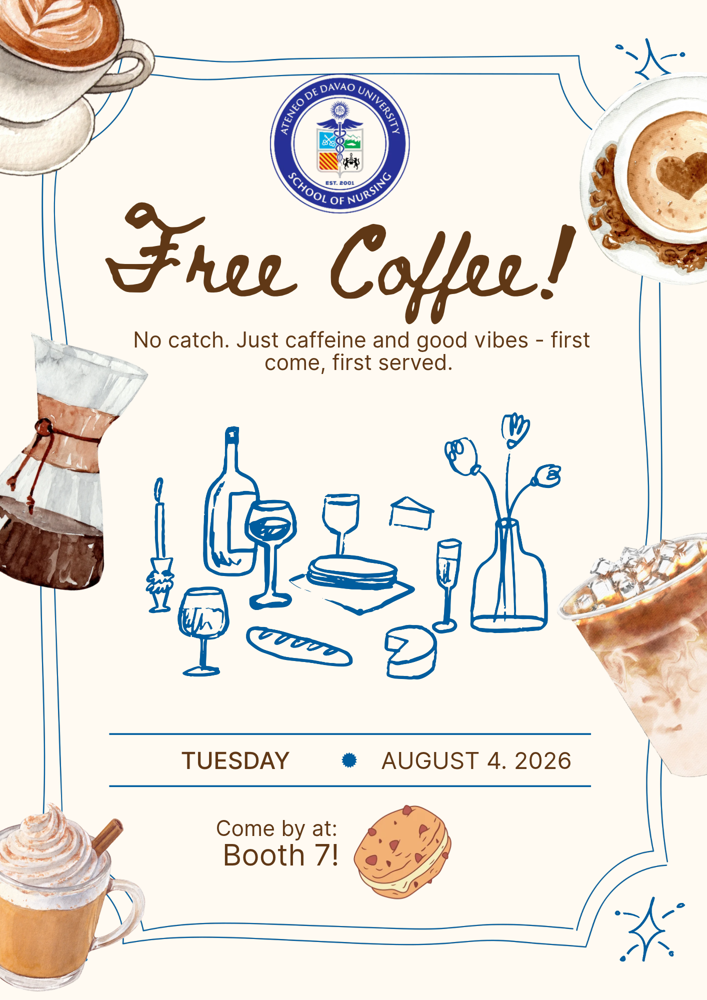

# ☕ "Free Coffee!" Event Poster

---

## 📌 About This Activity

> A digital poster promoting a **free coffee giveaway** for the Ateneo de Davao University School of Nursing, scheduled for **Tuesday, August 4, 2026 at Booth 7**.

The goal was to design an attractive, easy-to-read announcement using a warm cream background, hand-drawn style illustrations, and bold script lettering so passersby would notice it instantly.

---

## 💡 What Have I Learned?

| 🔑 Key Skills | 🧗 Challenge & Solution | 🚀 Future Use |
|---|---|---|
| Visual hierarchy, choosing a limited color palette, and balancing text with illustrations. | Too many decorations made the poster feel crowded, so I kept the key details (date and booth) in a clear banner with plenty of space around them. | I can apply this to health-awareness posters and school event announcements. |

- ✅ A good poster puts the **most important information first** (what, when, where).
- ✅ Matching colors and a consistent theme make a design look professional.
- ✅ Simple, uncluttered layouts are easier to read than busy ones.

---

⬅️ [Back to main repository](../README.md) &nbsp;|&nbsp; ➡️ [Next: Activity 2](../A2-Personal%20Branding/README.md)

