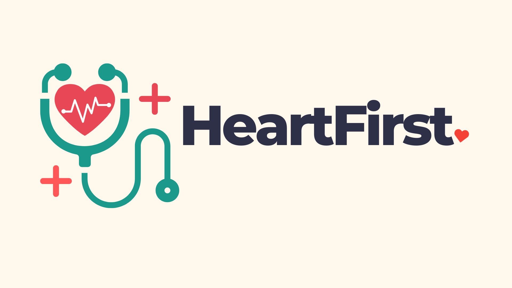
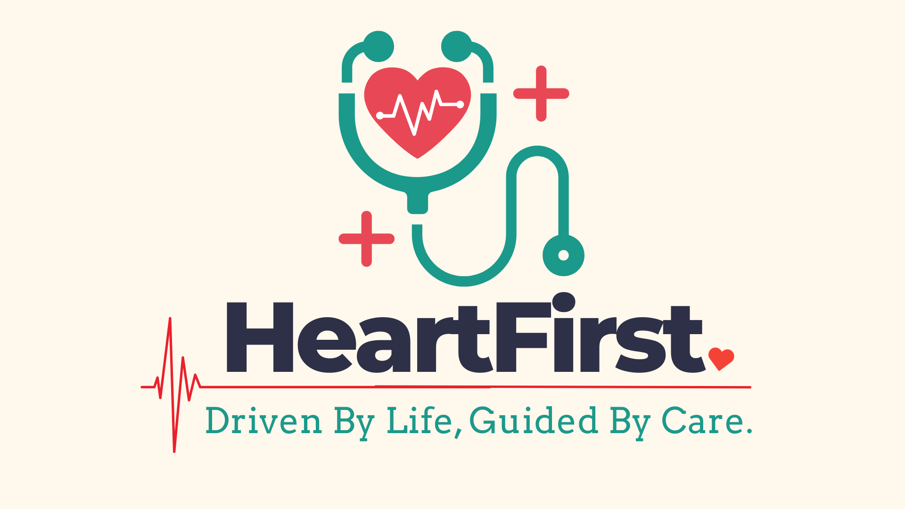
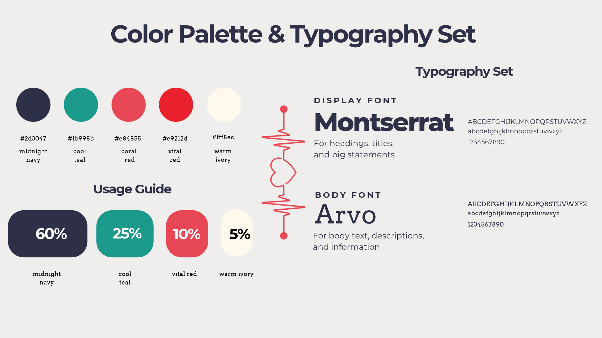
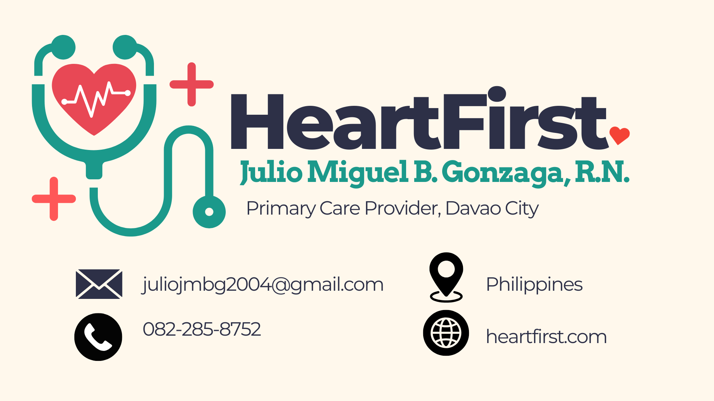

# 🩺 HeartFirst: Brand Identity Kit

*"Driven By Life, Guided By Care."*

---

## 📌 About This Activity

> I created a complete brand identity for **HeartFirst**, a personal brand for a nurse primary care provider. The kit has four parts: a **mini logo**, a **full logo**, a **color palette with typography**, and a **business card**. The logo combines a **stethoscope**, a **heart**, and a **pulse line** to show care and clinical skill.

### 🧩 What's Inside

| 1️⃣ Mini Logo | 2️⃣ Full Logo |
|:---:|:---:|
|  |  |
| Icon with the brand name | Stacked layout with the tagline |

| 3️⃣ Color Palette & Typography | 4️⃣ Business Card |
|:---:|:---:|
|  |  |
| Five colors and two fonts | Logo, name, and contact details |

### 🌈 Palette (60 / 25 / 10 / 5 rule)

| Color | Hex | Name | Use |
|:---:|:---:|:---|:---:|
|  | `#2d3047` | Midnight Navy | 60% |
|  | `#1b998b` | Cool Teal | 25% |
|  | `#e84855` | Coral Red / Vital Red | 10% |
|  | `#fff8ec` | Warm Ivory | 5% |

🔤 **Fonts:** Montserrat for headings and Arvo for body text.

---

## 💡 What Have I Learned?

| 🔑 Key Skills | 🧗 Challenge & Solution | 🚀 Future Use |
|---|---|---|
| Symbolism in logo design, color proportions, font pairing, and keeping one brand consistent across items. | Fitting the logo, name, and four contact details on the card without crowding was hard, so I grouped the details in two columns with icons. | I can use the kit for a professional portfolio, a future clinic, and health education materials. |

- ✅ A strong logo uses **simple shapes that carry meaning**.
- ✅ Reusing the same logo, colors, and fonts makes a brand recognizable.
- ✅ A brand needs several versions (mini, full, card) to fit different spaces.

---

⬅️ [Previous: Activity 1](../A1-Presentation%20Design%20Principles/README.md) &nbsp;|&nbsp; ➡️ [Next: Activity 3](../A3-Social%20Media%20Infographic%20%26%20Project%20Doc/README.md)

