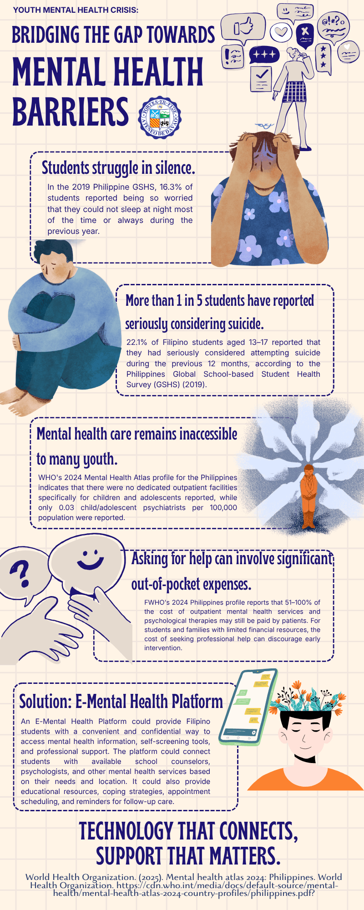

# 🧠 Bridging the Mental Health Access Gap Among Filipino Youth

---

## 📌 About This Activity

> I made an **infographic** and a **project documentation paper** about the barriers Filipino students face in getting mental health support. Both propose a **Digital Mental Health Support Platform** (a website and mobile app) that gives students confidential information, self-screening tools, and referrals to professionals.

### 📊 Key Points

| Barrier | What the sources say |
|:---|:---|
| 😟 **Silent struggle** | 16.3% of students reported worry so severe they could not sleep (2019 GSHS). |
| 🚨 **Seriousness of the issue** | 22.1% of students aged 13 to 17 had seriously considered attempting suicide in the past 12 months. |
| 🏥 **Limited services** | No outpatient facilities specifically for children and adolescents were reported, and only 0.03 child and adolescent psychiatrists per 100,000 people (WHO, 2025). |
| 💸 **Cost** | 51% to 100% of the cost of outpatient mental health services may be paid by patients. |

### 💡 Proposed Solution

A platform that complements, and does not replace, professional care. It could include:

- 📚 Evidence-based mental health information
- 📝 Self-screening questionnaires
- 📅 Appointment scheduling and follow-up reminders
- 📍 A directory of counselors, psychologists, and psychiatrists, with location-based referrals

📄 Full paper: [`ProjectDocumentation_GONZAGA.pdf`](ProjectDocumentation_GONZAGA.pdf)

> 💙 **If you or someone you know is struggling,** please reach out to a trusted person, a school counselor, or a mental health professional.

---

## 💡 What Have I Learned?

| 🔑 Key Skills | 🧗 Challenge & Solution | 🚀 Future Use |
|---|---|---|
| Finding reliable sources, citing in APA, and turning statistics into a clear infographic. | Fitting a lot of data into one infographic was hard, so I picked one key statistic per section and used short headlines. | I can design health education materials and propose programs that make care more accessible. |

- ✅ **Credible sources** (WHO, UNICEF, peer-reviewed studies) make a paper trustworthy.
- ✅ An infographic works best with **one message per section**.
- ✅ Technology can help bridge access gaps, but it cannot replace trained professionals.

---

⬅️ [Previous: Activity 2](../A2-Personal%20Branding/README.md) &nbsp;|&nbsp; ➡️ [Next: Activity 4](../A4-Google%20Workspace%20Group%20Reporting/README.md)

