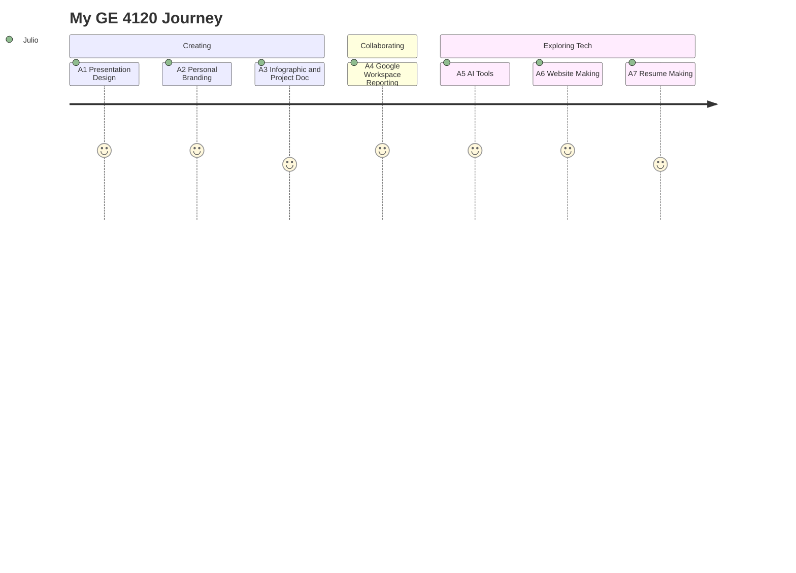

<table>
<tr>
<td width="32%" align="center" valign="middle">

</td>
<td width="68%" align="left" valign="middle">

<h3>Hey there! I'm Julio Miguel 👋</h3>

</td>
</tr>
</table>

---

## 🌈 A Little About Me

<table>
<tr>
<td width="60%" valign="top">

Hello! I'm Julio, a fourth-year nursing student who is always curious about learning new things, whether inside or outside the hospital.

While most of my academic journey revolves around nursing and medicine, I also enjoy exploring creative hobbies and discovering how technology can make everyday tasks easier.

> 💬 *"You don't have to be an expert to start learning something new!"*

</td>
<td width="40%" valign="top">

**✨ A few things I enjoy**

🍳 Cooking and trying new recipes 
🎌 Watching anime 
📚 Reading books 
🩺 Learning about nursing and medicine 
💻 Exploring digital tools and technology

</td>
</tr>
</table>

---

## 🛠️ What I Learned This Semester

My GE 4120 journey introduced me to digital skills I can use as a student and as a future nurse. I learned to use **Google Workspace** efficiently, design my projects with **Canva**, and make the most of **AI tools** such as ChatGPT and Claude.

### 🗺️ My Learning Journey

---

## 📂 My Work

Click any card to open that activity ⬇️

 

<table>
<tr>
<td width="50%" valign="top">

### 🎨 [A1 | Presentation Design Principles](A1-Presentation%20Design%20Principles)
Learning how to create visually engaging and organized presentations.

[**Open activity →**](A1-Presentation%20Design%20Principles)

</td>
<td width="50%" valign="top">

### ✨ [A2 | Personal Branding](A2-Personal%20Branding)
Building a personal identity: logos, color palette, typography, and a business card.

[**Open activity →**](A2-Personal%20Branding)

</td>
</tr>
<tr>
<td width="50%" valign="top">

### 📱 [A3 | Social Media Infographic & Project Doc](A3-Social%20Media%20Infographic%20%26%20Project%20Doc)
Turning research on youth mental health into a visual infographic and an organized project paper.

[**Open activity →**](A3-Social%20Media%20Infographic%20%26%20Project%20Doc)

</td>
<td width="50%" valign="top">

### 🤝 [A4 | Google Workspace Group Reporting](A4-Google%20Workspace%20Group%20Reporting)
Collaborating, sharing files, and reporting as a group using Google Slides.

[**Open activity →**](A4-Google%20Workspace%20Group%20Reporting)

</td>
</tr>
<tr>
<td width="50%" valign="top">

### 🤖 [A5 | AI Tools Activity](A5-AI%20Tools%20Activity)
Exploring how AI can assist productivity and academic work by comparing ChatGPT and Claude.

[**Open activity →**](A5-AI%20Tools%20Activity)

</td>
<td width="50%" valign="top">

### 🌐 [A6 | Website Making](A6-Website%20Making)
Building a one-page website for my cold brew coffee shop idea, "Little Cuppa".

[**Open activity →**](A6-Website%20Making) &nbsp;•&nbsp; [**Live site ↗**](https://little-cuppa-brew--jmbgonzaga.replit.app)

</td>
</tr>
<tr>
<td width="50%" valign="top">

### 📄 [A7 | Resume Making](A7-Resume%20Making)
Creating a professional one-page resume with AI and comparing Claude and Gemini.

[**Open activity →**](A7-Resume%20Making)

</td>
<td width="50%" valign="top">

### 🚀 What's Next?
Continuing to discover new tools, develop my skills, and learn beyond the classroom!

</td>
</tr>
</table>

---

## ⭐ Featured: Little Cuppa Website

*"Good things come cold."* ☕

&nbsp;

---

## 📋 Quick Overview

| | Folder | What it's about |
|:-:|:--|:--|
| 🎨 | [A1-Presentation Design Principles](A1-Presentation%20Design%20Principles) | Design principles applied to a poster |
| ✨ | [A2-Personal Branding](A2-Personal%20Branding) | Logo, palette, fonts, and business card |
| 📱 | [A3-Social Media Infographic & Project Doc](A3-Social%20Media%20Infographic%20%26%20Project%20Doc) | Infographic and project paper |
| 🤝 | [A4-Google Workspace Group Reporting](A4-Google%20Workspace%20Group%20Reporting) | Group report on Google Slides |
| 🤖 | [A5-AI Tools Activity](A5-AI%20Tools%20Activity) | ChatGPT vs. Claude |
| 🌐 | [A6-Website Making](A6-Website%20Making) | One-page website with Replit AI |
| 📄 | [A7-Resume Making](A7-Resume%20Making) | AI-assisted resume |

---

### 💙 Thanks for stopping by!

*Still learning, still growing, and always curious.*

